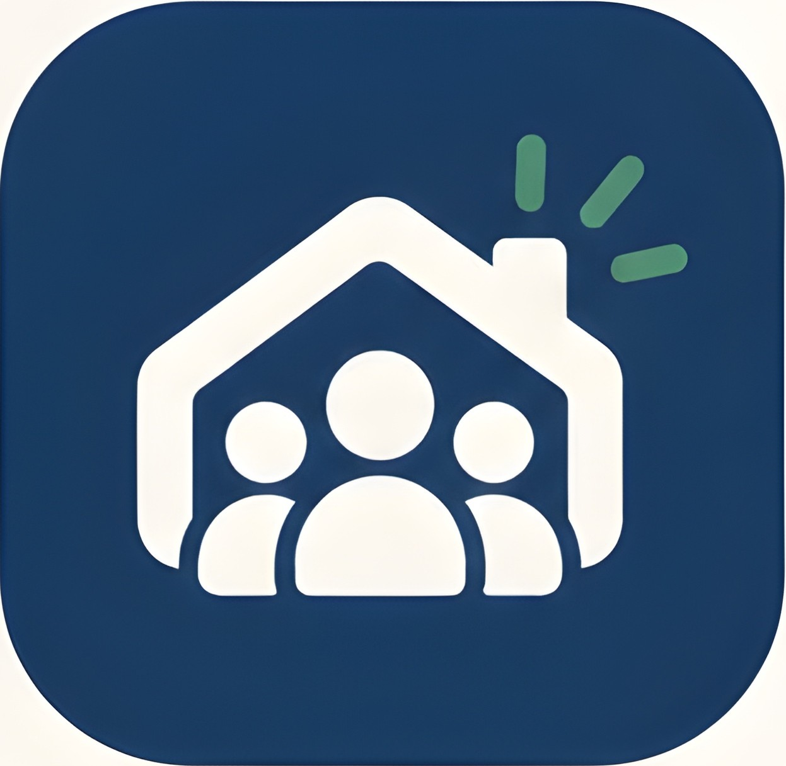

# 🏘️ RadioPatio — La red social de tu barrio

> *"La red social de tu barrio"*

<p align="center">
  
</p>

<p align="center">
  <a href="https://skillicons.dev">
    
  </a>
</p>

[](https://kotlinlang.org/)
[](https://www.android.com/)
[](https://developer.android.com/jetpack/compose)
[-blue.svg)](https://developer.android.com)
[-green.svg)](https://developer.android.com)

---

## 📖 Índice
1. [Sobre el Proyecto](#-sobre-el-proyecto)
2. [Equipo de Desarrollo](#-equipo-de-desarrollo)
3. [Objetivos del Sistema](#-objetivos-del-sistema)
4. [Módulos y Funcionalidades](#-módulos-y-funcionalidades)
5. [Tecnologías y Arquitectura](#-tecnologías-y-arquitectura)
6. [Instalación y Configuración](#-instalación-y-configuración)


---

## 🌟 Sobre el Proyecto

**RadioPatio** es una aplicación móvil nativa para Android desarrollada íntegramente en **Kotlin** con **Jetpack Compose**. Nace con el propósito de crear un espacio digital hiperlocal de comunicación, colaboración y convivencia entre vecinos. 

A través de una experiencia dinámica e intuitiva, RadioPatio permite compartir avisos en tiempo real, organizar actividades comunitarias, resolver incidencias, prestar ayuda mutua y fomentar la economía circular mediante un mercado vecinal de compraventa y préstamo de objetos.

---

## 👥 Equipo de Desarrollo
Proyecto desarrollado para la asignatura Software para Dispositivos Móviles del grado en Ingeniería Informática (Universidad de Oviedo):
| 👤 Name                        | 📧 Email                    | 🐱 GitHub                                                                 |
| :----------------------------: | :------------------------: | :------------------------------------------------------------------------: |
| Patricia Lago Martín           | UO294435@uniovi.es          | [](https://github.com/patriilaago) |
| Eloy Rubio Suárez              | UO298184@uniovi.es          | [](https://github.com/EloyRsua) |
| Natalia Blanco Agudín          | UO295340@uniovi.es          | [](https://github.com/NataliaBlancoAgudin) |


## 🎯 Objetivos del Sistema

* **Facilitar la comunicación:** Romper la barrera del anonimato en edificios y barrios, agilizando el contacto directo entre vecinos.
* **Centralizar la información:** Reunir avisos, cortes de suministros, reuniones y noticias comunitarias en un canal único y accesible.
* **Fomentar la colaboración vecinal:** Crear dinámicas de apoyo mutuo y organización de eventos vecinales.
* **Economía circular y sostenibilidad:** Promover el intercambio, compraventa y préstamo ("prestes") de objetos cotidianos para reducir el desperdicio y ahorrar recursos.

---

## 🚀 Módulos y Funcionalidades

### 1. 📰 Feed de Publicaciones e Historias
* **Publicaciones de texto:** Microblogging ágil estilo *X (Twitter)* para compartir inquietudes, preguntas, avisos y novedades del día a día.
* **Interacciones sociales:** Sistema de "Me gusta", hilo de comentarios y opción de compartir publicaciones hacia plataformas externas (*WhatsApp, Instagram*).
* **Noticias fijadas:** Anuncios prioritarios creados por administradores destacados en color verde institucional, anclados visualmente durante el desplazamiento y con vigencia programable (1 día, 1 semana, 1 mes o ilimitado).

### 2. 👥 Comunidad y Directorio de Vecinos
* **Perfiles vecinales:** Cada usuario dispone de perfil público con nombre, fotografía de perfil y breve descripción biográfica.
* **Comunidades segmentadas:** Clasificación por tipología (**Edificio** o **Vecindario**), con soporte multirred (un vecino puede pertenecer a más de una comunidad a la vez).
* **Acceso restringido:** Acceso seguro bajo registro previo para garantizar la privacidad comunitaria.

### 3. 🛍️ Mercadillo Vecinal ("Compraventa" y "Prestes")
* **Compraventa de proximidad:** Artículos de segunda mano categorizados (Muebles, Electrónica, Ropa, Deporte/Bicis, etc.) con precio, distancia y antigüedad del anuncio.
* **Sistema de "Prestes" (Préstamos solidarios):** Servicio de préstamo temporal de herramientas, libros o electrodomésticos entre vecinos con plazos acordados.
* **Resolución de incidencias:** Si un objeto no se reintegra en el plazo acordado, el prestador puede reportar el perfil; el sistema generará automáticamente una **publicación especial fijada** en el muro comunitario para mediación y resolución vecinal.
* **Favoritos y Búsqueda:** Filtros por categoría y guardado de artículos de interés.

### 4. 💬 Mensajería Directa
* Chat privado e instantáneo entre vecinos para coordinar entregas del mercadillo, resolver dudas o contactar directamente a la administración comunitaria.

### 5. 📅 Eventos y Avisos
* Calendario y tablón de actividades vecinales (fiestas de barrio, reuniones de comunidad, quedadas deportivas o solidarias).

---

## 💻 Tecnologías y Arquitectura
- **Lenguaje:** Kotlin 2.0.0
- **Plataforma:** Android Nativo
- **Interfaz de Usuario:** Jetpack Compose con Material 3
- **Iconografía:** androidx.compose.material:material-icons-extended
- **Nivel de API:**
    - ``minSdk``: 29 (Android 10.0)
    - ``compileSdk`` / ``targetSdk``: 35 (Android 15)
- Compatibilidad JVM: Java 11

---

## ⚙️ Instalación y Configuración
Requisitos Previos
- **Android Studio** (versión Koala, Ladybug o superior recomendada).
- **JDK 11** instalado y configurado en las variables de entorno o en la configuración de Android Studio.
- Dispositivo físico Android (con depuración USB habilitada) o Emulador con Android 10.0 (API 29) o superior.


Pasos para Ejecutar
1. **Clonar el repositorio:**
```bash
git clone https://github.com/EloyRsua/RadioPatio.git
```
2. **Abrir en Android Studio:**
    - Selecciona ``File > Open...`` y escoge la carpeta raíz del proyecto.
    - Espera a que la sincronización de Gradle finalice con éxito.
3. **Compilar y desplegar:**
    - Haz clic en el botón Run (``Shift + F10``) con un emulador o dispositivo seleccionado.
